# JOBSHEET 9 - ARRAY 1 DIMENSI

**Identitas Mahasiswa:**
* **Nama:** Saefira Bahari
* **NIM:** 264107020247
* **Kelas / No. Presensi:** TI-1D/26

---

## 1: TUJUAN PRAKTIKUM

Berikut adalah tujuan pelaksanaan praktikum pada bab ini:

1. Memahami konsep array 1 dimensi serta cara mendeklarasikan, menginisialisasi, dan mengakses elemennya dalam bahasa Java.
2. Membuat program yang menggunakan array 1 dimensi untuk menyimpan dan mengolah data dengan perulangan `for` dan `foreach`.
3. Menerapkan operasi aritmatika pada elemen array, seperti menghitung total, rata-rata, nilai tertinggi, dan nilai terendah.
4. Menerapkan algoritma pencarian (*searching*) dan pengurutan (*sorting*) sederhana pada array 1 dimensi.
5. Menggunakan array 1 dimensi untuk menyelesaikan studi kasus yang relevan dengan kehidupan kampus dan sehari-hari.

---

## 2: HASIL PERCOBAAN & ANALISIS

### 2.1 Percobaan 1: Deklarasi, Inisialisasi, Mengisi, dan Menampilkan Elemen Array

Percobaan ini membuat array integer berisi empat bilangan, lalu menampilkannya dengan perulangan `for`, `foreach`, dan `Arrays.toString()`. Indeks array dimulai dari 0, sementara jumlah elemennya dapat diketahui melalui `.length`.

#### 2.1.1 Kode Program Java

```java
package week12;
import java.util.Arrays;
public class arrayBilangan26 {
    public static void main(String[] args) {
        int[] bil = {5, 13, -7, 17};
        for (int i = 0; i < bil.length; i++) {
            System.out.println("bil[" + i + "] = " + bil[i] + ", double = " + (bil[i] * 2));
        }
        for (int nilai : bil) {
            System.out.println(nilai);
        }
        System.out.println(Arrays.toString(bil));
    }
}
```

#### 2.1.2 Hasil Running / Screenshot Output

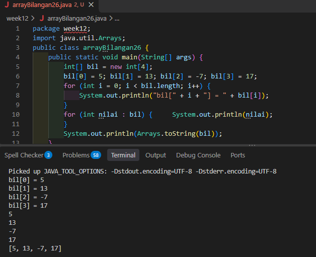

Saat nilai `5.0` dan `7.5` dimasukkan ke array bertipe `int`, program tidak dapat dikompilasi karena nilai desimal tidak dapat dikonversi secara otomatis menjadi bilangan bulat. Elemen array dapat langsung diinisialisasi saat deklarasi, seperti `int[] bil = {5, 13, -7, 17};`. Pada baris yang menampilkan `bil[i] * 2`, program mencetak nilai array beserta hasil perkalian nilainya dengan dua.

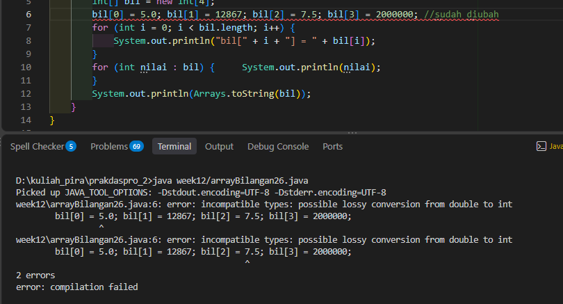

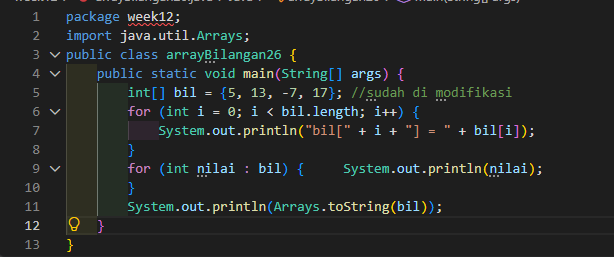

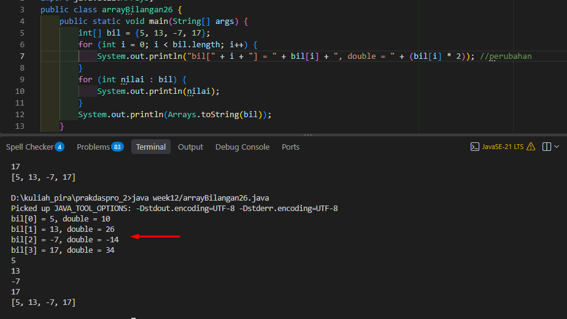

Jika batas perulangan diubah sehingga mencoba mengakses indeks 4, program mengalami `ArrayIndexOutOfBoundsException`, karena indeks valid untuk array berukuran empat hanya 0 sampai 3.

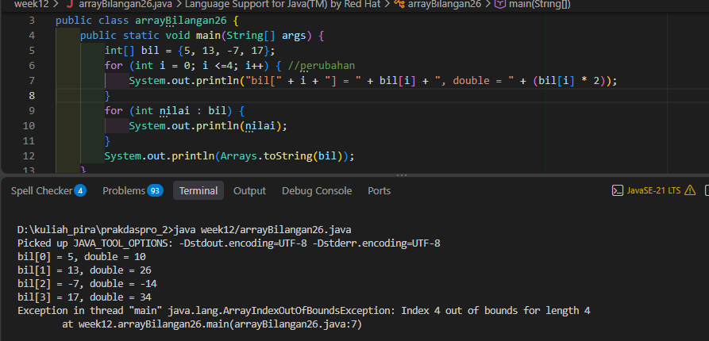

#### 2.1.3 Jawaban Pertanyaan / Pertanyaan Refleksi

* **Pertanyaan 1:** Apa perbedaan antara `for`, `foreach`, dan `Arrays.toString()` untuk menampilkan array, dan kapan masing-masing digunakan?
  * **Jawab:** `for` biasa digunakan saat indeks elemen diperlukan, misalnya untuk menampilkan posisi atau mengubah elemen. `foreach` membaca setiap nilai dengan lebih sederhana ketika indeks tidak dibutuhkan. Sementara itu, `Arrays.toString(bil)` menampilkan seluruh isi array sekaligus, cocok untuk pemeriksaan cepat atau debugging.

### 2.2 Percobaan 2: Input Nilai Mahasiswa dan Status Kelulusan

Percobaan ini menyimpan nilai sepuluh mahasiswa ke dalam array, lalu menampilkan nilai dan status kelulusannya. Mahasiswa dinyatakan lulus apabila nilainya lebih besar dari 70. Pengembangan percobaan juga menampilkan hanya mahasiswa yang lulus dan menghitung jumlah mahasiswa lulus serta tidak lulus.

#### 2.2.1 Kode Program Java

```java
package week12;
import java.util.Scanner;
public class arrayNilai26 {
    public static void main(String[] args) {
        int[] nilaiAkhir = new int[10];
        Scanner input = new Scanner(System.in);

        for (int i = 0; i < nilaiAkhir.length; i++) {
            System.out.print("Masukkan nilai mahasiswa ke-" + (i + 1) + ": ");
            nilaiAkhir[i] = input.nextInt();
        }
        int jumlahLulus = 0; //variabel
        int jumlahTidakLulus = 0;
        for (int i = 0; i < nilaiAkhir.length; i++) { //kembali menjadi for loop biasa
            String status = (nilaiAkhir[i] > 70) ? "LULUS" : "TIDAK LULUS";
            System.out.println("Mahasiswa ke-" + (i + 1) + ": " + nilaiAkhir[i] + " (" + status + ")");
            if (nilaiAkhir[i] > 70) { //menambahkan if else untuk menghitung jumlah
                jumlahLulus++;
            } else {
                jumlahTidakLulus++;
            }
        }
        System.out.println("Jumlah mahasiswa lulus: " + jumlahLulus);
        System.out.println("Jumlah mahasiswa tidak lulus: " + jumlahTidakLulus);
    }
}
```

#### 2.2.2 Hasil Running / Screenshot Output

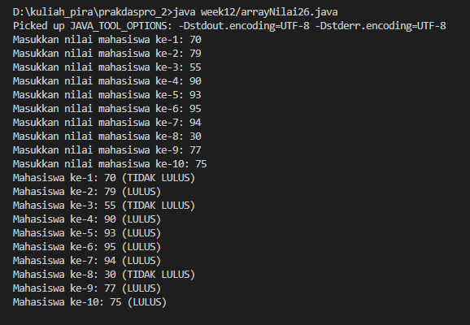

Program dapat menampilkan hanya nilai yang lulus dengan memeriksa kondisi `nilai > 70` sebelum mencetaknya. Perulangan input tetap menggunakan `for` biasa karena diperlukan indeks untuk menyimpan nilai ke posisi array yang sesuai. Bagian yang hanya membaca dan menampilkan elemen dapat menggunakan `foreach`; penghitung terpisah dapat digunakan jika nomor mahasiswa tetap perlu ditampilkan.

Contoh modifikasi untuk menampilkan mahasiswa yang lulus saja dengan `foreach`:

```java
int nomorMahasiswa = 1;
for (int nilai : nilaiAkhir) {
    if (nilai > 70) {
        System.out.println("Mahasiswa ke-" + nomorMahasiswa + ": " + nilai + " (LULUS)");
    }
    nomorMahasiswa++;
}
```

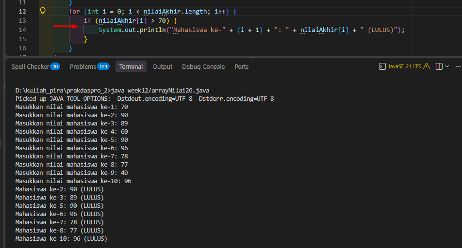

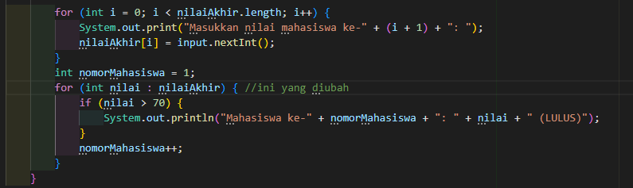

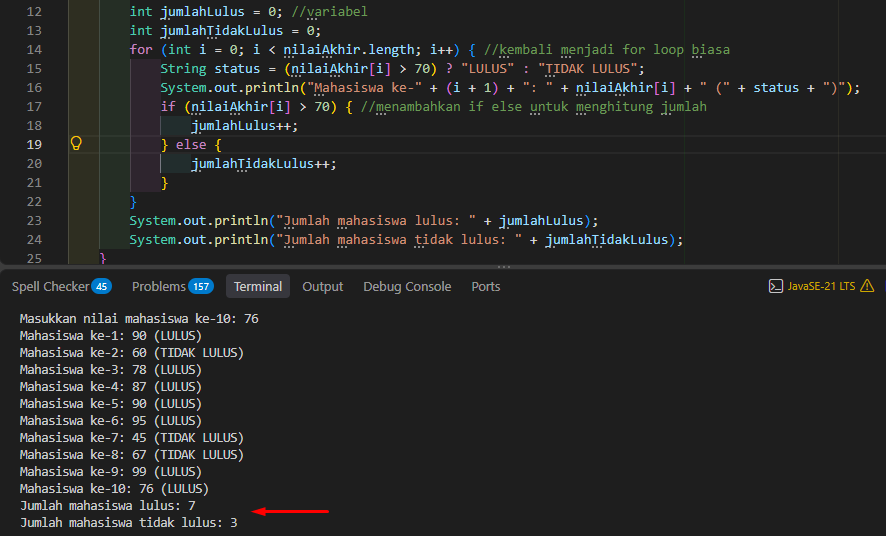

#### 2.2.3 Jawaban Pertanyaan / Pertanyaan Refleksi

* **Pertanyaan 1:** Apa maksud kondisi `i < nilaiAkhir.length`?
  * **Jawab:** `nilaiAkhir.length` bernilai 10, sehingga kondisi tersebut membuat `i` berjalan dari 0 sampai 9. Dengan demikian, setiap indeks array yang valid diproses tepat satu kali.
* **Pertanyaan 2:** Bagaimana cara menampilkan mahasiswa yang lulus saja?
  * **Jawab:** Gunakan `if` sebelum perintah cetak. Nilai hanya ditampilkan jika `nilai > 70`; jika kondisinya salah, program melewati perintah cetak tersebut.
* **Pertanyaan 3:** Apakah semua perulangan dapat diganti menjadi `foreach`?
  * **Jawab:** Tidak selalu. `foreach` cocok untuk membaca dan memproses nilai tanpa indeks. Untuk mengisi elemen array pada indeks tertentu atau membutuhkan nomor indeks, `for` biasa lebih sesuai.

### 2.3 Percobaan 3: Total, Rata-rata, Nilai Tertinggi, dan Terendah

Program meminta jumlah mahasiswa, menyimpan nilai mereka ke array, lalu menghitung total, rata-rata, jumlah yang lulus, nilai tertinggi, nilai terendah, dan predikat kelas. Jumlah array dibuat berdasarkan input pengguna dan divalidasi agar lebih dari nol.

#### 2.3.1 Kode Program Java

```java
package week12;
import java.util.Scanner;
public class arrayRataNilai26 {
    public static void main(String[] args) {
        Scanner input = new Scanner(System.in);
        System.out.print("Masukkan jumlah mahasiswa: "); //input jumlah mhs
        int jumlahMhs = input.nextInt();
        while (jumlahMhs <= 0) { //validasi jumlah mhs
            System.out.print("Jumlah mahasiswa harus lebih dari 0. Masukkan kembali: ");
            jumlahMhs = input.nextInt();
        }
        int[] nilaiMhs = new int[jumlahMhs];// memasukan jumlah mhs sebagai jumlah indeks
        int total = 0; double rata2;
        int mhsLulus = 0; //variabel
        for (int i = 0; i < nilaiMhs.length; i++) {
            System.out.print("Masukkan nilai mahasiswa ke-" + (i + 1) + ": ");
            nilaiMhs[i] = input.nextInt();
            total += nilaiMhs[i];
            if (nilaiMhs[i] > 70) { // menambahkan if
                mhsLulus++;
            }
        }
        rata2 = (double) total / nilaiMhs.length;
        System.out.println("Total nilai: " + total);
        System.out.println("Rata-rata: " + rata2);
        System.out.println("Jumlah mahasiswa yang lulus: " + mhsLulus);
        int tertinggi = nilaiMhs[0]; int terendah = nilaiMhs[0];
        for (int i = 1; i < nilaiMhs.length; i++) {
            if (nilaiMhs[i] > tertinggi) tertinggi = nilaiMhs[i];
                if (nilaiMhs[i] < terendah) terendah = nilaiMhs[i];
        }
        String predikat;
        if (rata2 >= 85) {
            predikat = "Sangat Baik";
        } else if (rata2 >= 70) {
            predikat = "Baik";
        } else {
            predikat = "Perlu Pendampingan";
        }
        System.out.println("Nilai tertinggi: " + tertinggi);
        System.out.println("Nilai terendah: " + terendah);
        System.out.println("Predikat: " + predikat);
        
    }
}
```

#### 2.3.2 Hasil Running / Screenshot Output

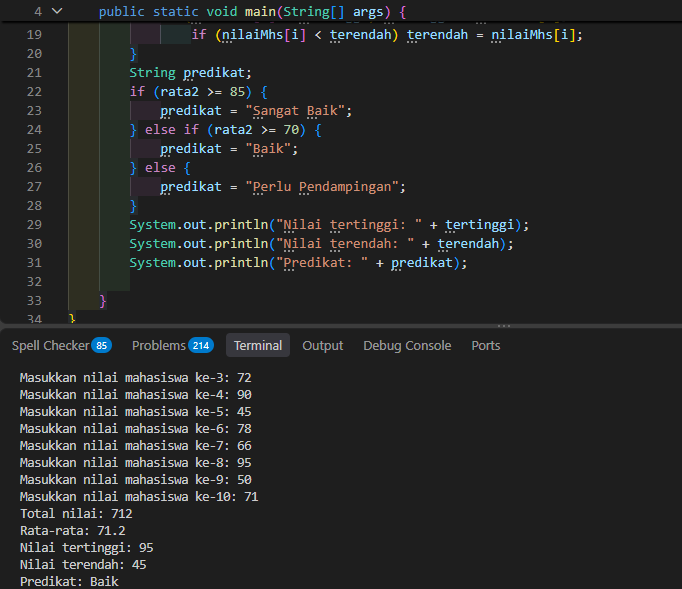

Jumlah mahasiswa lulus dihitung dengan menambah penghitung setiap kali nilai lebih besar dari 70. Ketika kapasitas array ditentukan dari input, semua perhitungan tetap menggunakan `nilaiMhs.length`, sehingga jumlah data mengikuti ukuran array yang sebenarnya.

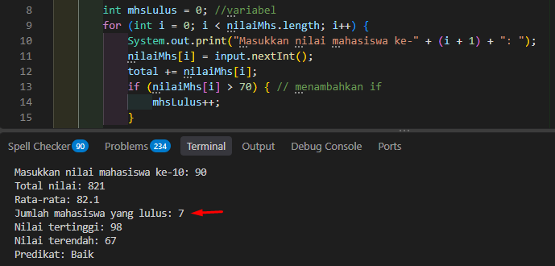

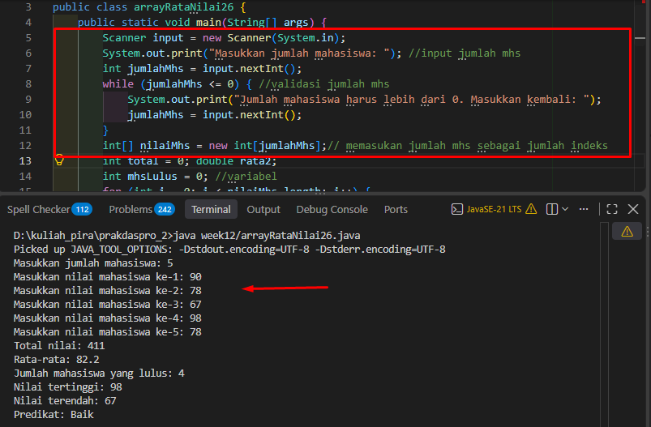

#### 2.3.3 Jawaban Pertanyaan / Pertanyaan Refleksi

* **Pertanyaan 1:** Mengapa rata-rata dihitung dengan `(double) total / nilaiMhs.length`?
  * **Jawab:** `(double) total` mengubah `total` menjadi bilangan desimal sebelum dibagi. Tanpa konversi tersebut, Java melakukan pembagian bilangan bulat dan membuang bagian desimal. Penggunaan `double` membuat hasil rata-rata lebih akurat.

### 2.4 Percobaan 4: Pencarian (*Searching*) dan Pengurutan (*Sorting*)

Percobaan ini menggunakan *linear search* untuk mencari nilai di dalam array dan *bubble sort* untuk mengurutkan nilai. Pencarian memeriksa elemen satu per satu. Pada *bubble sort*, elemen yang bersebelahan dibandingkan lalu ditukar hingga tersusun.

#### 2.4.1 Kode Program Linear Search

```java
package week12;
import java.util.Arrays;
import java.util.Scanner;
public class searchNilai26 {
    public static void main(String[] args) {
        Scanner input = new Scanner(System.in);
        System.out.print("Masukkan jumlah nilai: "); //input jumlah nilai
        int jumlahNilai = input.nextInt();
        while (jumlahNilai <= 0) { //validasi jumlah nilai
            System.out.print("Jumlah nilai harus lebih dari 0. Masukkan kembali: ");
            jumlahNilai = input.nextInt();
        }
        int[] nilai = new int[jumlahNilai];
        System.out.println("Masukkan " + jumlahNilai + " nilai:");
        for (int i = 0; i < jumlahNilai; i++) { //input nilai ke dalam array
            System.out.print("Masukkan nilai ke-" + (i + 1) + ": ");
            nilai[i] = input.nextInt();
        }
        System.out.print("Masukkan nilai yang ingin dicari: "); //input nilai yang ingin dicari
        int key = input.nextInt();
        boolean ditemukan = false;
        for (int i = 0; i < nilai.length; i++) { //loop untuk mencari nilai
            if (nilai[i] == key) {
                System.out.println("Nilai " + key + " ditemukan pada indeks ke-" + i);
                ditemukan = true;
                break;
            }
        }
        if (!ditemukan) {
            System.out.println("Nilai yang dicari (" + key + ") tidak ditemukan dalam array "
            + Arrays.toString(nilai) + ".");
        }
    }
}
```

#### 2.4.2 Hasil Running Linear Search

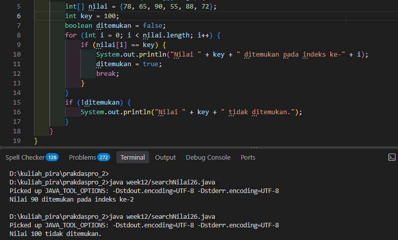

`break` menghentikan perulangan segera setelah nilai ditemukan sehingga elemen berikutnya tidak perlu diperiksa. Jika pencarian gagal, program menampilkan nilai `key` dan isi array agar hasilnya lebih informatif.

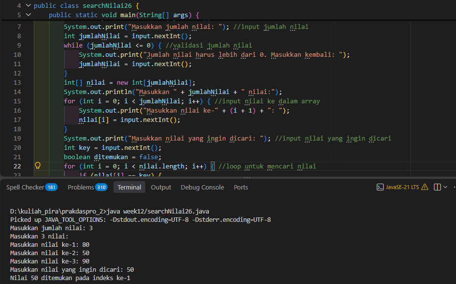

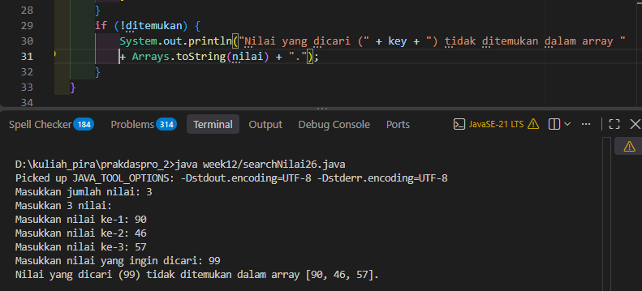

#### 2.4.3 Kode Program Bubble Sort

Berikut adalah program pengurutan menaik (*ascending*) dari percobaan:

```java
package week12;
import java.util.Arrays;
public class sortNilai26 {
    public static void main(String[] args) {
        int[] nilai = {78, 65, 90, 55, 88, 72};
        for (int i = 0; i < nilai.length - 1; i++) {
            for (int j = 0; j < nilai.length - 1 - i; j++) {
                if (nilai[j] > nilai[j + 1]) {
                    int temp = nilai[j];
                    nilai[j] = nilai[j + 1];
                    nilai[j + 1] = temp;
                }
            }
        }
        System.out.println(Arrays.toString(nilai));
    }
}
```

#### 2.4.4 Hasil Running Bubble Sort

Pada setiap putaran, nilai yang lebih besar berpindah ke posisi yang lebih kanan. Dengan data `{78, 65, 90, 55, 88, 72}`, hasil setelah diurutkan menaik adalah `[55, 65, 72, 78, 88, 90]`.

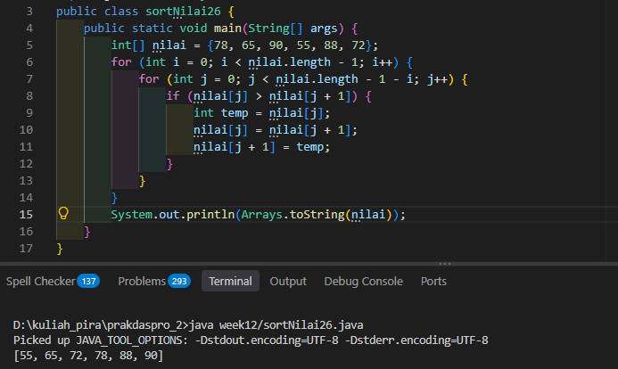

#### 2.4.5 Jawaban Pertanyaan / Pertanyaan Refleksi

* **Pertanyaan 1:** Jelaskan maksud `break` pada pencarian.
  * **Jawab:** Setelah nilai ditemukan, `break` menghentikan perulangan pencarian karena nilai yang dicari sudah ditemukan.
* **Pertanyaan 2:** Bagaimana cara kerja *bubble sort* untuk data uji?
  * **Jawab:** Algoritma membandingkan dua angka yang bersebelahan dan menukarnya jika urutannya salah. Pada putaran pertama, `{78, 65, 90, 55, 88, 72}` menjadi `{65, 78, 55, 88, 72, 90}`. Putaran kedua menghasilkan `{65, 55, 78, 72, 88, 90}`, kemudian putaran ketiga menghasilkan `{55, 65, 72, 78, 88, 90}`. Putaran berikutnya tidak mengubah urutan karena data sudah terurut.
* **Pertanyaan 3:** Bagaimana mengubah pengurutan menjadi menurun (*descending*)?
  * **Jawab:** Tukar dua elemen bersebelahan apabila elemen kiri lebih kecil dari elemen kanan. Kode akhir pada `sortNilai26.java` menggunakan kondisi tersebut dan menghasilkan urutan `[90, 88, 78, 72, 65, 55]`.

Kode akhir untuk pengurutan menurun:

```java
package week12;
import java.util.Arrays;
public class sortNilai26 {
    public static void main(String[] args) {
        int[] nilai = {78, 65, 90, 55, 88, 72};
    for (int i = 0; i < nilai.length - 1; i++) {
        for (int j = 0; j < nilai.length - 1 - i; j++) {
            if (nilai[j] < nilai[j + 1]) {
                int temp = nilai[j];
                nilai[j] = nilai[j + 1];
                nilai[j + 1] = temp;
            }
        }
    }
    System.out.println(Arrays.toString(nilai));
    }
}
```

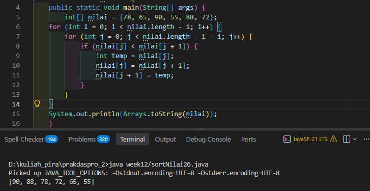

---

## 3: TUGAS MANDIRI

### 3.1 Tugas 1: Pengelolaan Nilai Mahasiswa

Program meminta jumlah mahasiswa dan nilai masing-masing mahasiswa. Selanjutnya program menampilkan nilai beserta status kelulusan, total, rata-rata, nilai tertinggi, dan nilai terendah.

#### Kode Program Java

```java
package week12;
import java.util.Arrays;
import java.util.Scanner;
public class tugas1 {
    public static void main(String[] args) {
        Scanner input = new Scanner(System.in);
        System.out.print("Masukkan jumlah mahasiswa: "); //input jumlah mhs
        int jumlahMhs = input.nextInt();
        while (jumlahMhs <= 0) { //validasi jumlah mhs
            System.out.print("Jumlah mahasiswa harus lebih dari 0. Masukkan kembali: ");
            jumlahMhs = input.nextInt();
        }
        int[] nilaiMhs = new int[jumlahMhs];// memasukan jumlah mhs sebagai jumlah indeks
        int total = 0; double rata2;
        int mhsLulus = 0;
        for (int i = 0; i < nilaiMhs.length; i++) {
            System.out.print("Masukkan nilai mahasiswa ke-" + (i + 1) + ": ");
            nilaiMhs[i] = input.nextInt();
            total += nilaiMhs[i];
        }
        for (int i = 0; i < nilaiMhs.length; i++) { //kembali menjadi for loop biasa
            String status = (nilaiMhs[i] > 70) ? "LULUS" : "TIDAK LULUS";
            System.out.println("Mahasiswa ke-" + (i + 1) + ": " + nilaiMhs[i] + " (" + status + ")");
        }
        rata2 = (double) total / nilaiMhs.length;
        System.out.println("Total nilai: " + total);
        System.out.println("Rata-rata: " + rata2);
        int tertinggi = nilaiMhs[0]; int terendah = nilaiMhs[0];
        for (int i = 1; i < nilaiMhs.length; i++) {
            if (nilaiMhs[i] > tertinggi) tertinggi = nilaiMhs[i];
                if (nilaiMhs[i] < terendah) terendah = nilaiMhs[i];
        }
        System.out.println("Nilai tertinggi: " + tertinggi);
        System.out.println("Nilai terendah: " + terendah);
    }
}
```

#### Hasil Running / Screenshot Output

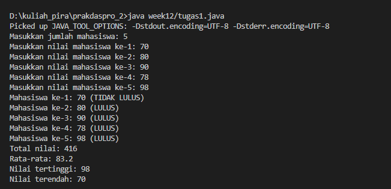

### 3.2 Tugas 2: Aplikasi Pemesanan Kafe Kampus

Program menyediakan array menu dan harga, mencari menu yang diminta, menerima beberapa pesanan yang tervalidasi terhadap daftar menu, menyimpan pesanan pada array terpisah, lalu menghitung serta menampilkan total biaya.

#### Kode Program Java

```java
package week12;
import java.util.Arrays;
import java.util.Scanner;
public class tugas2 {
    public static void main(String[] args) {
        Scanner input = new Scanner(System.in);
        String[] menu = {"Nasi Goreng", "Mie Goreng", "Roti Bakar", "Kentang Goreng", "Teh Tarik", "Cappucino", "Chocolate Ice"};
        int[] harga = {15000, 13000, 10000, 12000, 8000, 18000, 20000};
        System.out.print("Masukkan makanan yang ingin dicari: ");
        boolean ditemukan = false;
        String key = input.nextLine();
        for (int i = 0; i < menu.length; i++) {
            if (menu[i].equalsIgnoreCase(key)) {
                System.out.println("Makanan " + key + " ditemukan pada indeks ke-" + i);
                System.out.println("Harga: " + harga[i]);
                ditemukan = true;
                break;
            }
        }
        if (!ditemukan) {
            System.out.println("Makanan yang dicari (" + key + ") tidak ditemukan dalam array ");
        }
        System.out.print("Masukkan jumlah item yang ingin dipesan: ");
        int jmlhPesanan = input.nextInt();
        while (jmlhPesanan <= 0) {
            System.out.print("Jumlah item harus lebih dari 0. Masukkan kembali: ");
            jmlhPesanan = input.nextInt();
        }
        input.nextLine();
        String[] pesanan = new String[jmlhPesanan];
        int totalBiaya = 0;
        for (int i = 0; i < pesanan.length; i++) {
            boolean menuValid = false;
            while (!menuValid) {
                System.out.print("Masukkan nama menu pesanan ke-" + (i + 1) + ": ");
                String namaPesanan = input.nextLine();
                for (int j = 0; j < menu.length; j++) {
                    if (menu[j].equalsIgnoreCase(namaPesanan.trim())) {
                        pesanan[i] = menu[j];
                        totalBiaya += harga[j];
                        menuValid = true;
                        break;
                    }
                }
                if (!menuValid) {
                    System.out.println("Menu tidak tersedia. Pilih dari: " + Arrays.toString(menu));
                }
            }
        }
        System.out.println("======= Struk Pesanan =======");
        System.out.println("Daftar pesanan: " + Arrays.toString(pesanan));
        System.out.println("Total biaya: Rp" + totalBiaya);
    }
}
```

#### Hasil Running / Screenshot Output

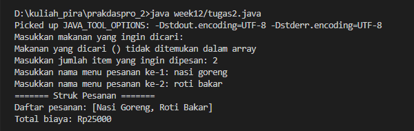

---

## 4: KESIMPULAN

Array 1 dimensi dapat digunakan untuk menyimpan kumpulan data bertipe sama dan mengolahnya menggunakan indeks serta perulangan. Pada praktikum ini, array digunakan untuk menghitung statistik nilai, menentukan status kelulusan, mencari dan mengurutkan data, serta mengelola daftar pesanan dan total biayanya. Pemilihan `for`, `foreach`, pencarian linear, dan *bubble sort* disesuaikan dengan kebutuhan pengolahan data.
