# JOBSHEET 11 - ARRAY 2 DIMENSI

**Identitas Mahasiswa:**
* **Nama:** Saefira Bahari
* **NIM:** 264107020247
* **Kelas / No. Presensi:** TI-1D/26

---

## 1: TUJUAN PRAKTIKUM

Berikut adalah tujuan pelaksanaan praktikum pada bab ini:

1. Mendeklarasikan, menginstansiasi, dan menginisialisasi array 2 dimensi dalam bahasa Java.
2. Mengakses dan mengisi elemen array 2 dimensi menggunakan indeks baris dan kolom.
3. Memproses array 2 dimensi dengan nested loop, baik `for` maupun `foreach`.
4. Membuat array 2 dimensi dengan panjang baris yang berbeda (*jagged array*).
5. Menghitung nilai rata-rata per baris dan per kolom pada studi kasus nyata.

---

## 2: HASIL PERCOBAAN & ANALISIS

### 2.1 Percobaan 1: Deklarasi, Inisialisasi, dan Menampilkan Array 2 Dimensi

Percobaan ini membuat array `String` untuk menyimpan nama penonton bioskop mini dengan 4 baris dan 2 kolom. Program mengisi elemen berdasarkan indeks, menampilkan data, dan memeriksa panjang array utama maupun setiap baris.

#### 2.1.1 Kode Program Java

```java
package week13;

public class bioskop26 {
    public static void main(String[] args) {
        String[][] penonton = new String[4][2];
        penonton[0][0] = "Amin";
        penonton[0][1] = "Bena";
        penonton[1][0] = "Candra";
        penonton[1][1] = "Dela";
        penonton[2][0] = "Eka";
        penonton[2][1] = "Farhan";
        penonton[3][0] = "Gisel";
        penonton[3][1] = "Hana";

        System.out.printf("%s \t %s\n", penonton[0][0], penonton[0][1]);
        System.out.printf("%s \t %s\n", penonton[1][0], penonton[1][1]);
        System.out.printf("%s \t %s\n", penonton[2][0], penonton[2][1]);
        System.out.printf("%s \t %s\n", penonton[3][0], penonton[3][1]);
        System.out.println(penonton.length);

        for (String[] barisPenonton : penonton) {
            System.out.println("Panjang baris: " + barisPenonton.length);
        }
        for (int i = 0; i < penonton.length; i++) {
            System.out.println("Penonton pada baris ke-" + (i + 1) + ": " + String.join(", ", penonton[i]));
        }
    }
}
```

#### 2.1.2 Hasil Running / Screenshot Output

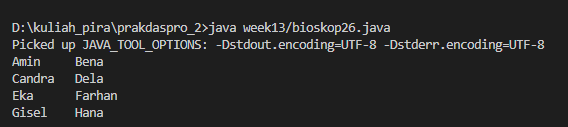

Array `penonton` memiliki empat baris, sehingga nilai `penonton.length` adalah `4`. Setiap baris memiliki dua kolom. Indeks dimulai dari 0, sehingga indeks baris maksimal adalah 3 dan indeks kolom maksimal adalah 1.

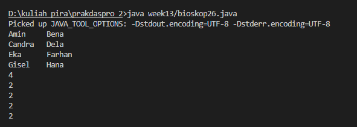

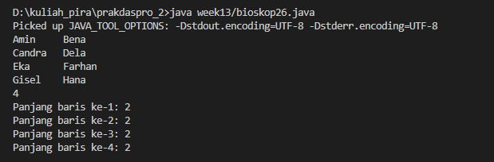

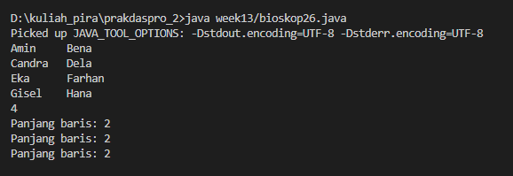

Perulangan `for` cocok saat indeks baris atau kolom diperlukan. `foreach` lebih ringkas untuk membaca seluruh nilai, tetapi tidak memberikan akses langsung ke indeks. Untuk menampilkan semua penonton pada satu baris, `String.join(", ", penonton[i])` menggabungkan nama-nama dengan koma dan spasi sebagai pemisah.

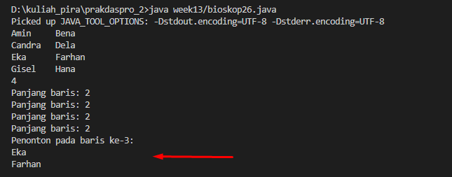

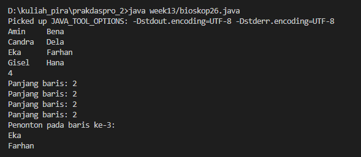

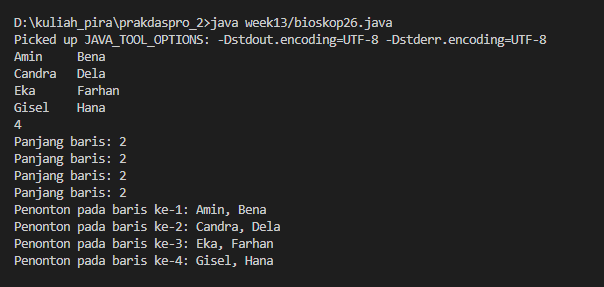

#### 2.1.3 Jawaban Pertanyaan / Pertanyaan Refleksi

* **Pertanyaan 1:** Apakah pengisian elemen array harus dilakukan secara berurutan mulai dari indeks ke-0?
  * **Jawab:** Tidak harus. Setiap elemen dapat diisi melalui indeks baris dan kolom yang sesuai. Pengisian secara berurutan hanya memudahkan pengorganisasian data.
* **Pertanyaan 2:** Mengapa terdapat `null` pada daftar nama penonton?
  * **Jawab:** Elemen bertipe `String` yang belum diisi memiliki nilai default `null`. Setelah semua elemen diisi, tidak ada lagi elemen `null`.
* **Pertanyaan 3:** Apakah panjang setiap baris sama?
  * **Jawab:** Ya. Pada array `new String[4][2]`, setiap baris memiliki dua elemen.
* **Pertanyaan 4:** Apa kelebihan dan kekurangan `foreach` dibandingkan `for`?
  * **Jawab:** `foreach` lebih sederhana dan mudah dibaca ketika indeks tidak diperlukan. Kekurangannya, indeks tidak tersedia secara langsung sehingga kurang sesuai jika program perlu mengetahui atau mengubah posisi elemen.
* **Pertanyaan 5:** Apa fungsi `String.join()`?
  * **Jawab:** `String.join()` menggabungkan beberapa `String` menjadi satu teks dengan pemisah yang diberikan sebagai parameter pertama.
* **Pertanyaan diskusi:** Apa perbedaan `penonton[1] = null` dengan `penonton[1][0] = null`?
  * **Jawab:** `penonton[1] = null` membuat seluruh referensi baris kedua menjadi `null`, sehingga mengakses `penonton[1].length` menyebabkan `NullPointerException`. Sementara itu, `penonton[1][0] = null` hanya membuat satu elemen pada baris tersebut kosong; barisnya tetap ada dan panjangnya masih dapat diakses.
* **Pertanyaan diskusi:** Apakah jumlah baris array dapat berubah setelah dibuat?
  * **Jawab:** Tidak. Ukuran array tetap setelah diinstansiasi. Untuk menambah baris, program perlu membuat array baru dengan ukuran lebih besar dan menyalin data, atau menggunakan struktur dinamis seperti `ArrayList`.

### 2.2 Percobaan 2: Scanner dan Perulangan untuk Input dan Output Array 2 Dimensi

Percobaan ini mengembangkan array penonton dengan input menggunakan `Scanner` dan menu untuk memasukkan serta menampilkan data. Program juga memeriksa apakah posisi kursi berada dalam rentang array dan apakah kursi tersebut sudah terisi.

#### 2.2.1 Kode Program Java

```java
package week13;
import java.util.Scanner;
public class bioskopScanner26 {
    public static void main(String[] args) {
        Scanner sc = new Scanner(System.in);
        int baris, kolom, menu;
        String nama, pilihan;
        String[][] penonton = new String[4][2];
        while (true) {
            System.out.println("-----Menu-----");
            System.out.println("1. Input data penonton");
            System.out.println("2. Tampilkan daftar penonton");
            System.out.println("3. Exit");
            System.out.print("Pilih menu: ");
            menu = sc.nextInt();
            sc.nextLine();
            switch (menu) {
                case 1:
                    do {
                            System.out.print("Masukkan nama: ");
                            nama = sc.nextLine();

                            while (true) {
                                System.out.print("Masukkan baris: ");
                                baris = sc.nextInt();

                                System.out.print("Masukkan kolom: ");
                                kolom = sc.nextInt();
                                sc.nextLine();

                                if (baris < 1 || baris > penonton.length ||
                                    kolom < 1 || kolom > penonton[0].length) {
                                    System.out.println("Nomor baris atau kolom tidak tersedia!");
                                } else if (penonton[baris - 1][kolom - 1] != null) {
                                    System.out.println("Kursi sudah terisi! Silakan pilih kursi lain.");
                                } else {
                                    break;
                                }
                            }

                            penonton[baris - 1][kolom - 1] = nama;
                            System.out.println("Data berhasil ditambahkan!");

                            System.out.print("Input penonton lainnya? (y/n): ");
                            pilihan = sc.nextLine();

                        } while (pilihan.equalsIgnoreCase("y"));
                        break;
                case 2:
                    System.out.println("\n=== DAFTAR PENONTON ===");
                    for (int i = 0; i < penonton.length; i++) {
                        for (int j = 0; j < penonton[i].length; j++) {
                            System.out.print(
                                (penonton[i][j] == null ? "***" : penonton[i][j]) + "\t"
                            );
                        }
                        System.out.println();
                    }
                    break;
                case 3:
                    System.out.println("Program selesai.");
                    sc.close();
                    return;
                default:
                    System.out.println("Pilihan menu tidak tersedia!");
            }
        }
    }
}
```

#### 2.2.2 Hasil Running / Screenshot Output

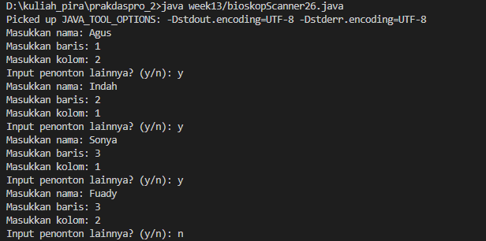

Pengisian kursi tidak harus berurutan. Pengguna memasukkan nomor baris dan kolom; program kemudian mengakses array pada indeks `baris - 1` dan `kolom - 1`, karena nomor yang dimasukkan pengguna dimulai dari 1 sedangkan indeks array dimulai dari 0.

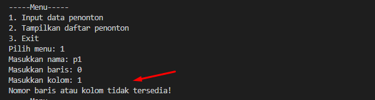

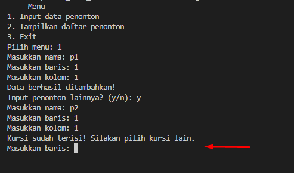

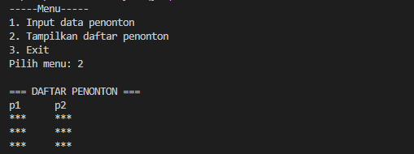

#### 2.2.3 Jawaban Pertanyaan / Pertanyaan Refleksi

* **Pertanyaan 1:** Apakah pengisian elemen array dari `Scanner` harus berurutan mulai dari indeks ke-0?
  * **Jawab:** Tidak. Pengguna dapat menentukan posisi baris dan kolom yang ingin diisi selama posisi tersebut masih berada dalam ukuran array dan kursinya belum terisi.
* **Pertanyaan 2:** Bagaimana menangani nomor baris atau kolom yang tidak tersedia?
  * **Jawab:** Periksa rentang baris dan kolom sebelum mengakses array. Jika tidak valid, tampilkan pesan dan minta pengguna memasukkan posisi kembali.
* **Pertanyaan 3:** Bagaimana mendeteksi kursi yang sudah terisi?
  * **Jawab:** Periksa apakah `penonton[baris - 1][kolom - 1] != null`. Jika benar, kursi sudah terisi dan program meminta posisi lain.
* **Pertanyaan 4:** Bagaimana menampilkan kursi kosong sebagai `***`?
  * **Jawab:** Gunakan operator ternary saat mencetak: jika elemennya `null`, cetak `"***"`; jika tidak, cetak nama penonton.
* **Pertanyaan diskusi:** Apa yang terjadi jika pengguna mengetik huruf pada prompt baris?
  * **Jawab:** `nextInt()` melempar `InputMismatchException` karena token bukan bilangan bulat. Program dapat diperkuat dengan memeriksa `hasNextInt()`, membuang token yang salah, lalu meminta input kembali.
* **Pertanyaan diskusi:** Bagaimana jika ukuran kursi ditentukan oleh pengguna?
  * **Jawab:** Baca jumlah baris dan kolom sebelum membuat array, lalu gunakan nilai tersebut saat menginstansiasi array. Ukuran array tidak dapat diubah setelah dibuat; untuk mengubah ukuran, buat array baru dan salin data lama.

### 2.3 Percobaan 3: Array 2 Dimensi dengan Panjang Baris Berbeda

Percobaan ini menggunakan *jagged array*, yaitu array 2 dimensi yang panjang setiap barisnya dapat berbeda. Program menginisialisasi tiga baris dengan panjang 7, 3, dan 1. Panjang baris pertama yang semula 5 pada langkah awal jobsheet kemudian diganti menjadi 7.

#### 2.3.1 Kode Program Java

```java
package week13;
public class numbers26 {
    public static void main(String[] args) {
        int[][] myNumbers = new int[3][];
        myNumbers[0] = new int[7];
        myNumbers[1] = new int[3];
        myNumbers[2] = new int[1];


        System.out.println("Panjang array utama: " + myNumbers.length);
        System.out.println("Panjang baris pertama: " + myNumbers[0].length);
        System.out.println("");
        for (int i = 0; i < myNumbers.length; i++) {
            System.out.println("Panjang baris ke-" + (i + 1) + ": " + myNumbers[i].length);
        }

    }
}
```

#### 2.3.2 Hasil Running / Screenshot Output

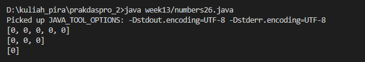

Nilai default setiap elemen `int` adalah `0`. `Arrays.toString(myNumbers[i])` menampilkan isi dari satu baris. Jika `Arrays.toString()` langsung dipanggil pada array 2 dimensi, hasilnya berupa representasi objek untuk setiap array baris. `Arrays.deepToString(myNumbers)` dapat digunakan untuk menampilkan isi seluruh array 2 dimensi secara rekursif.

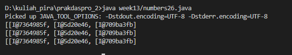

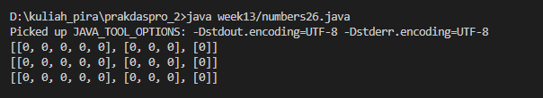

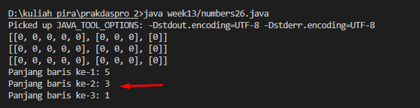

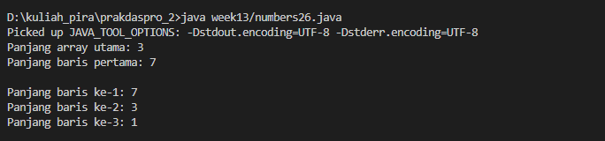

#### 2.3.3 Jawaban Pertanyaan / Pertanyaan Refleksi

* **Pertanyaan 1:** Apa fungsi `Arrays.toString()`?
  * **Jawab:** `Arrays.toString()` mengubah isi array satu dimensi menjadi teks yang mudah dibaca, dengan elemen-elemen ditampilkan di dalam tanda kurung siku.
* **Pertanyaan 2:** Apa perbedaan `Arrays.toString(myNumbers)` dan `Arrays.deepToString(myNumbers)`?
  * **Jawab:** `Arrays.toString()` pada array 2 dimensi hanya menampilkan representasi objek dari array-array baris. `Arrays.deepToString()` menampilkan isi elemen di seluruh tingkat array.
* **Pertanyaan 3:** Apa nilai default elemen bertipe `int`?
  * **Jawab:** Nilai defaultnya adalah `0`.
* **Pertanyaan 4:** Apakah panjang array dapat dimodifikasi setelah diinstansiasi?
  * **Jawab:** Tidak. Panjang array tetap. Program dapat membuat array baris baru dengan ukuran berbeda dan menetapkannya pada posisi baris tertentu.
* **Pertanyaan 5:** Apa yang berubah setelah `myNumbers[0] = new int[7]` dijalankan?
  * **Jawab:** Panjang array utama tetap 3, tetapi panjang baris pertama berubah menjadi 7. Baris baru berisi nilai default `0`; nilai lama pada baris yang diganti tidak ikut dipertahankan.
* **Pertanyaan diskusi:** Mengapa perubahan pada `salinan[0][0]` juga dapat mengubah `myNumbers[0][0]` jika `int[][] salinan = myNumbers`?
  * **Jawab:** Penugasan tersebut menyalin referensi, bukan isi array. Kedua variabel menunjuk ke objek array yang sama. Penyalinan independen memerlukan pembuatan array baru dan penyalinan setiap baris atau elemen; `clone()` pada array utama saja masih menghasilkan salinan dangkal.

### 2.4 Percobaan 4: Studi Kasus SIAKAD

Program SIAKAD menyimpan nilai mahasiswa dalam array 2 dimensi. Loop luar memproses mahasiswa, sedangkan loop dalam memproses nilai mata kuliah. Program menghitung rata-rata setiap mahasiswa dan rata-rata untuk setiap mata kuliah. Jumlah mahasiswa dan mata kuliah dimasukkan melalui `Scanner`.

#### 2.4.1 Kode Program Java

```java
package week13;
import java.util.Scanner;
public class siakad26 {
    public static void main(String[] args) {
    Scanner sc = new Scanner(System.in);
            System.out.print("Jumlah mahasiswa: ");
            int jumlahMahasiswa = sc.nextInt();
            System.out.print("Jumlah mata kuliah: ");
            int jumlahMatkul = sc.nextInt();
            int[][] nilai = new int[jumlahMahasiswa][jumlahMatkul];

            for (int i = 0; i < nilai.length; i++) {
                System.out.println("Input nilai mahasiswa ke-" + (i + 1));
                double totalPerSiswa = 0;
                for (int j = 0; j < nilai[i].length; j++) {
                    System.out.print("Nilai mata kuliah " + (j + 1) + ": ");
                    nilai[i][j] = sc.nextInt();
                    totalPerSiswa += nilai[i][j];
                }
                System.out.println("Nilai rata-rata: " + totalPerSiswa / nilai[i].length);
            }
            System.out.println("\n========================================");
            System.out.println("Rata-rata nilai setiap mata kuliah:");
            for (int j = 0; j < nilai[0].length; j++) {
                double totalPerMatkul = 0;
                for (int i = 0; i < nilai.length; i++) {
                    totalPerMatkul += nilai[i][j];
                }
                System.out.println("Mata kuliah " + (j + 1) + ": " + totalPerMatkul / nilai.length);
            }
        }
    }
```

#### 2.4.2 Hasil Running / Screenshot Output

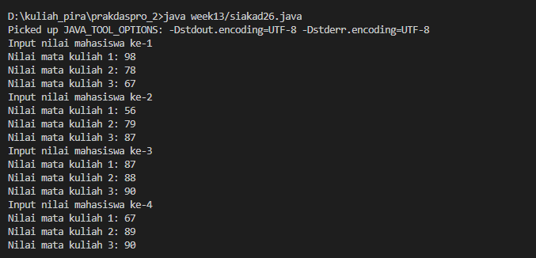

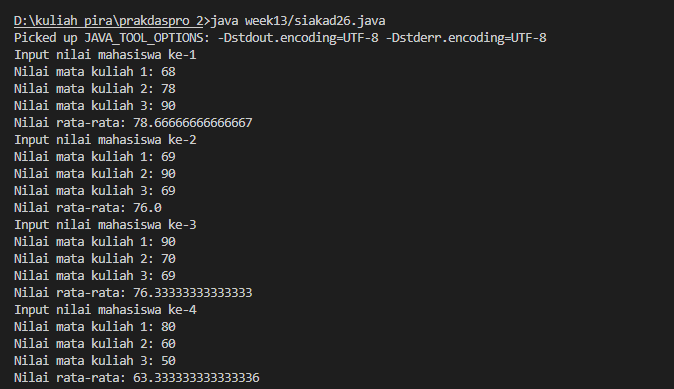

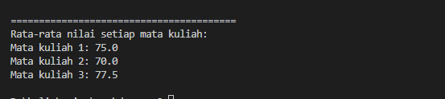

Rata-rata mahasiswa dihitung dengan menjumlahkan semua nilai pada satu baris, lalu membaginya dengan `nilai[i].length`. Rata-rata mata kuliah dihitung dengan menjumlahkan nilai pada satu kolom untuk seluruh mahasiswa, lalu membaginya dengan `nilai.length`. Dengan demikian, program tetap mengikuti ukuran array yang dimasukkan saat dijalankan.

#### 2.4.3 Jawaban Pertanyaan / Pertanyaan Refleksi

* **Pertanyaan 1:** Bagaimana menentukan jumlah mahasiswa dan mata kuliah saat program berjalan?
  * **Jawab:** Baca kedua jumlah tersebut menggunakan `Scanner`, lalu gunakan nilainya untuk membuat array, misalnya `new int[jumlahMahasiswa][jumlahMatkul]`. Perulangan menggunakan `.length` agar batasnya mengikuti ukuran array.
* **Pertanyaan 2:** Mengapa `totalPerSiswa` dideklarasikan di dalam loop luar?
  * **Jawab:** Agar total diinisialisasi ulang menjadi 0 untuk setiap mahasiswa. Jika diletakkan di luar loop tanpa di-reset, total mahasiswa berikutnya akan mencakup nilai mahasiswa sebelumnya.
* **Pertanyaan 3:** Bagaimana nilai default 0 memengaruhi rata-rata jika nilai belum diisi?
  * **Jawab:** Nilai 0 tetap ikut dijumlahkan dan menjadi bagian dari pembagi, sehingga rata-rata dapat menjadi lebih rendah. Jika program harus membedakan nilai yang belum diisi dari nilai 0 yang valid, diperlukan penanda tambahan atau tipe data lain.

---

## 3: TUGAS MANDIRI

### 3.1 Tugas: Implementasi Survei

Program menyimpan jawaban survei pada array 2 dimensi, kemudian menghitung rata-rata setiap responden, setiap pertanyaan, dan keseluruhan. Jawaban yang diperbolehkan berada pada rentang 1 sampai 5. Jobsheet meminta 10 responden dan 6 pertanyaan; kode saat ini menggunakan 2 responden dan 4 pertanyaan sebagai ukuran array.

#### Kode Program Java

```java
package week13;
import java.util.Scanner;

public class tugas26 {
    public static void main(String[] args) {
        Scanner sc = new Scanner(System.in);
        int[][] survei = new int[2][4];
        for (int i=0; i < survei.length; i++){ //loop responden
            System.out.println("Responden ke "+ (i + 1));
            int totalR=0; //inisialisasi untuk total responden
            for (int j=0; j < survei[i].length; j++){ //loop pertanyaan
                System.out.print("Jawaban pertanyaan ke " + (j + 1) + " : ");
                survei[i][j] = sc.nextInt();
                if (survei[i][j] < 1 || survei[i][j] > 5) { //validasi input
                    System.out.println("Jawaban tidak valid, masukkan jawaban(1-5)!");
                    j--; //mengulang jika input tidak valid
                    continue;
                }
                totalR += survei[i][j];//memasukan nilai setiap pertanyaan ke totalR
            }
            double rataR = (double) totalR / survei[i].length; //perhitungan rata" responden
            System.out.printf(" Rata-rata responden ke %d: %.2f%n", i + 1, rataR);
        }
        System.out.println("---Rata-rata setiap pertanyaan---");
        for (int i = 0; i < survei[0].length; i++) {
            int totalP = 0;
            for (int j = 0; j < survei.length; j++) {
                totalP += survei[j][i];
            }
            double rataP = (double) totalP / survei.length;
            System.out.printf("Rata-rata pertanyaan ke %d: %.2f%n", i + 1, rataP);
        }
        int totalSemua = 0;
        for (int i = 0; i < survei.length; i++) {
            for (int j = 0; j < survei[i].length; j++) {
                totalSemua += survei[i][j];
            }
        }
        double rataSemua = (double) totalSemua / (survei.length * survei[0].length);
        System.out.printf("\nRata-rata keseluruhan: %.2f%n", rataSemua);
        sc.close();
    }
}
```

Rata-rata responden dihitung dari jumlah jawaban pada satu baris dibagi jumlah pertanyaan. Rata-rata pertanyaan dihitung dari jumlah jawaban pada satu kolom dibagi jumlah responden. Rata-rata keseluruhan dihitung dari total seluruh jawaban dibagi jumlah responden dikalikan jumlah pertanyaan. Untuk memenuhi ukuran pada jobsheet, deklarasi array dapat disesuaikan menjadi `new int[10][6]`.

---

## 4: KESIMPULAN

Array 2 dimensi digunakan untuk menyimpan data berbentuk baris dan kolom. Nested loop memudahkan pengisian serta pemrosesan data, seperti daftar kursi bioskop dan nilai mahasiswa. Ukuran setiap baris dapat berbeda pada *jagged array*. Program juga dapat menghitung rata-rata per baris, per kolom, dan keseluruhan dengan menggunakan panjang array sebagai pembagi agar perhitungan mengikuti ukuran data.
